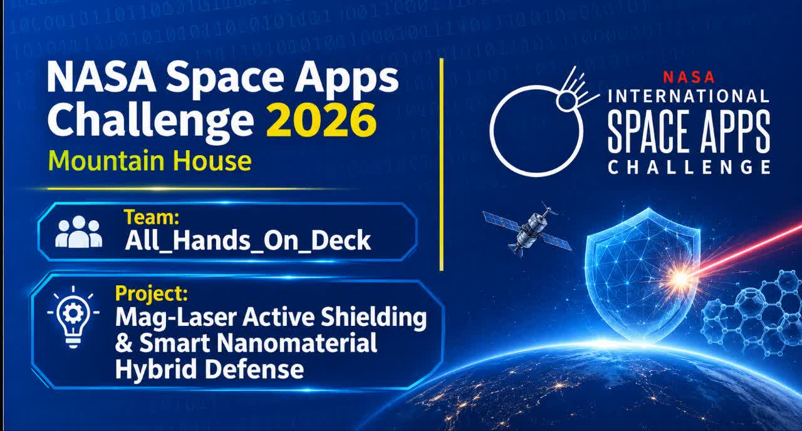

<div align="center">



<br><br>

# MAG-LASER

### ACTIVE SHIELDING & SMART NANOMATERIAL HYBRID DEFENSE

#### FOR DEEP SPACE HABITATS

**An Innovative Concept for Astronaut Radiation Protection**

<br>


<br><br>

*Protecting the Future of Human Space Exploration.*

<br>

[PROJECT OVERVIEW](#-project-overview) •
[PROTECTION ARCHITECTURE](#-four-layer-protection-architecture) •
[DASHBOARD](#-interactive-dashboard) •
[OUR TEAM](#-meet-the-team) •
[🚀 GO TO LIVE PROJECT →](https://allhandsondeck2026.github.io/MAG-LASER-Active-Shielding/)

</div>

---

# 🌌 Project Overview

Space exploration beyond Earth's protective magnetic environment introduces significant challenges for human health and mission safety.

Among these challenges, exposure to high-energy space radiation remains one of the major concerns for long-duration missions to the Moon, Mars, and other destinations in deep space.

**MAG-LASER** is a student-led conceptual research project exploring a hybrid, multi-layer radiation-protection architecture for future deep-space habitats.

The proposed concept investigates the integration of:

- Active electromagnetic shielding.
- Plasma-based technologies.
- Advanced hydrogenated nanomaterials.
- Intelligent energy management and backup systems.

By combining these approaches, MAG-LASER aims to investigate a complementary protection architecture that could contribute to future research into astronaut radiation safety.

<div align="center">

### FOUR LAYERS. ONE INTEGRATED CONCEPT.

**Active Shielding · Plasma Technology · Nanomaterials · Energy Management**

</div>

---

# 🎯 Project Objectives

Our primary objectives are to:

1. Explore the potential of active magnetic shielding for charged-particle deflection.
2. Investigate plasma-based shielding concepts.
3. Examine hydrogen-rich advanced nanomaterials for passive radiation protection.
4. Develop a redundant energy architecture for continuous system support.
5. Create an interactive dashboard to visualize the proposed system.
6. Present the concept through scientific research and technical documentation.

---

# 🛡️ Four-Layer Protection Architecture

MAG-LASER is structured around four complementary conceptual layers.

## 01 — Active Magnetic Braking

**Technology: Superconducting Electromagnetic Shielding**

The first layer explores the use of superconducting magnetic coils to generate a magnetic field around a protected habitat.

The concept investigates the interaction between charged particles and magnetic fields through the Lorentz force.

**Proposed Design Parameters:**

- Reference magnetic field: 0.25 Tesla.
- Superconducting coil architecture.
- Charged-particle deflection concept.
- Reference unit: 1 m².

---

## 02 — Plasma Window

**Technology: Argon–Helium Plasma Concept**

The second layer investigates a plasma-based approach using an Argon–Helium gas mixture.

The proposed architecture explores plasma behavior and particle interactions as part of a hybrid shielding concept.

**Proposed Design Parameters:**

- Argon–Helium working-gas concept.
- Plasma-based interaction research.
- Proposed closed-loop recycling target: 90%.

---

## 03 — Hydrogenated BNNT Nanomaterials

**Technology: Hydrogenated Boron Nitride Nanotubes**

The third layer explores advanced hydrogenated Boron Nitride Nanotubes (BNNTs) as a potential passive shielding material.

The research focuses on hydrogen-rich material structures and their potential relevance to radiation-protection applications.

**Proposed Design Parameters:**

- Hydrogenated BNNT material concept.
- Passive shielding architecture.
- No active electrical power requirement for the proposed passive layer.
- Intended passive operation during temporary power interruptions.

---

## 04 — Intelligent Energy & Fail-Safe System

**Technology: Kilopower Concept + Solid-State Backup Batteries**

The fourth layer investigates a redundant energy architecture designed to support the proposed protection system.

The concept combines a primary energy source with independent backup storage.

**Proposed Design Parameters:**

- Kilopower-based primary energy concept.
- Solid-state backup battery architecture.
- Proposed emergency standby capability: 48 hours.
- Emergency power budget reference: 102 W.

---

## 📊 System Architecture Summary

| Layer | Main Technology | Research Focus |
|:---:|---|---|
| 01 | Superconducting Magnets | Active Magnetic Shielding |
| 02 | Argon–Helium Plasma | Plasma-Based Concepts |
| 03 | Hydrogenated BNNTs | Passive Nanomaterial Shielding |
| 04 | Kilopower & Batteries | Energy Management & Redundancy |

---

# 💻 Interactive Dashboard

MAG-LASER includes a custom-developed interactive dashboard designed to visualize the proposed architecture and its operational concepts.

The interface follows a scientific mission-control design approach, providing an overview of the four protection layers and the proposed energy architecture.

### Dashboard Capabilities

- Four-layer protection status visualization.
- Magnetic shielding status interface.
- Plasma recycling indicators.
- Reactor and energy-system monitoring.
- Cosmic radiation alert interface.
- Emergency and fail-safe status indicators.
- Simulated telemetry visualization.
- Interactive 2D and 3D viewing modes.
- System status and reset controls.

<div align="center">

### 🚀 LIVE PROJECT DASHBOARD

**Explore the MAG-LASER project through its interactive live dashboard.**

<br>

<a href="https://allhandsondeck2026.github.io/MAG-LASER-Active-Shielding/">

</a>

<br><br>

*Click above to launch the live MAG-LASER project.*

</div>

---

# 🖥️ Dashboard Preview

<div align="center">


*Interactive visualization of the proposed MAG-LASER system.*

</div>

---

# 🧑‍💻 Technology Stack

The project combines software development, interface engineering, scientific visualization, and research documentation.

| Technology | Application |
|---|---|
| HTML5 | Dashboard structure |
| CSS3 | Interface design and styling |
| JavaScript | Interactive functionality |
| Git | Version control |
| GitHub | Project collaboration and hosting |
| Scientific Research | Technical investigation |
| Data Visualization | System monitoring interface |

---

# 👥 Meet the Team

## ALL HANDS ON DECK

An international student team participating in the NASA Space Apps Challenge 2026 – Baghdad.

| Team Member | Role & Contribution |
|---|---|
| **Mohammad Parsa Ghorbani** | Programming, Web Development & Interactive Dashboard Design |
| **Issa Ahmed Habib** | Team Leadership & Project Coordination |
| **Renad Braa** | Co-Programming, Technical Documentation & GitHub Repository Management |
| **Lamees Ahmed** | Scientific Research & Translation |
| **Ahmed Yasser** | Project Collaboration |

Our team combines different technical skills and perspectives to explore innovative approaches to scientific and engineering challenges.

---

# 🔬 Research & Scientific Background

MAG-LASER explores several scientific and engineering disciplines:

- Space Radiation Physics.
- Electromagnetism.
- Lorentz Force and Charged-Particle Dynamics.
- Plasma Physics.
- Superconducting Magnet Technology.
- Boron Nitride Nanotubes.
- Aerospace Engineering.
- Space Nuclear Power Systems.

Our research approach emphasizes scientific references, transparent technical assumptions, and a clear distinction between conceptual proposals and experimentally validated technologies.

### Research Resources

- [NASA](https://www.nasa.gov/)
- [NASA Langley Research Center](https://www.nasa.gov/centers-and-facilities/langley/)
- [NASA Space Radiation Research](https://www.nasa.gov/hrp/elements/radiation/)
- [NASA Space Apps Challenge](https://www.spaceappschallenge.org/)

Additional technical references and research materials will be organized in the `research/` directory.

---

# 📁 Repository Structure

```text
MAG-LASER/
│
├── README.md
│
├── index.html
│
└── assets/
    │
    ├── images/
    │   └── banner.png
    │
    ├── pdf/
    │   └── Aligned-Boron-Nitride-Nanotube-Reinforced-Polyethylene-Nanocomposite.pdf
    │
    ├── videos/
    │   ├── version1.mp4
    │   ├── version2.mp4
    │   └── version3.mp4
    │
    └── css/
        └── style.css
```

---

# ⚠️ Scientific Disclaimer

MAG-LASER is an independent student-led conceptual research project developed for the NASA Space Apps Challenge 2026.

The proposed architecture, engineering assumptions, performance figures, and operational scenarios are conceptual research parameters and have not been experimentally validated or certified for real-world spaceflight.

Dashboard telemetry, system states, and operational indicators are simulated for demonstration and educational purposes.

This project is not an officially developed, funded, endorsed, or validated NASA technology.

---

# 🌍 Our Vision

We believe the future of human space exploration will be shaped by scientific curiosity, engineering innovation, and international collaboration.

MAG-LASER represents our effort to explore challenging scientific questions and investigate potential approaches to one of the important challenges of deep-space exploration.

Our work is driven by the belief that meaningful innovation begins with an idea, develops through research, and advances through collaboration.

---

# 📬 Project & Team Information

**Project:** MAG-LASER

**Team:** All Hands On Deck

**Event:** NASA Space Apps Challenge 2026

**Location:** Baghdad, Iraq

**Live Project:** [GO TO LIVE PROJECT →](https://allhandsondeck2026.github.io/MAG-LASER-Active-Shielding/)

**GitHub Organization:** [allhandsondeck2026](https://github.com/allhandsondeck2026)

**Project Repository:** [MAG-LASER](https://github.com/allhandsondeck2026/MAG-LASER-Active-Shielding)

---

<div align="center">

<br>

# EXPLORE. RESEARCH. ENGINEER. INNOVATE.

### MAG-LASER

**Active Shielding & Smart Nanomaterial Hybrid Defense**

<br>

*One Team. Different Perspectives. A Shared Vision Beyond Earth.*

<br>

**ALL HANDS ON DECK**

NASA Space Apps Challenge 2026

</div>
